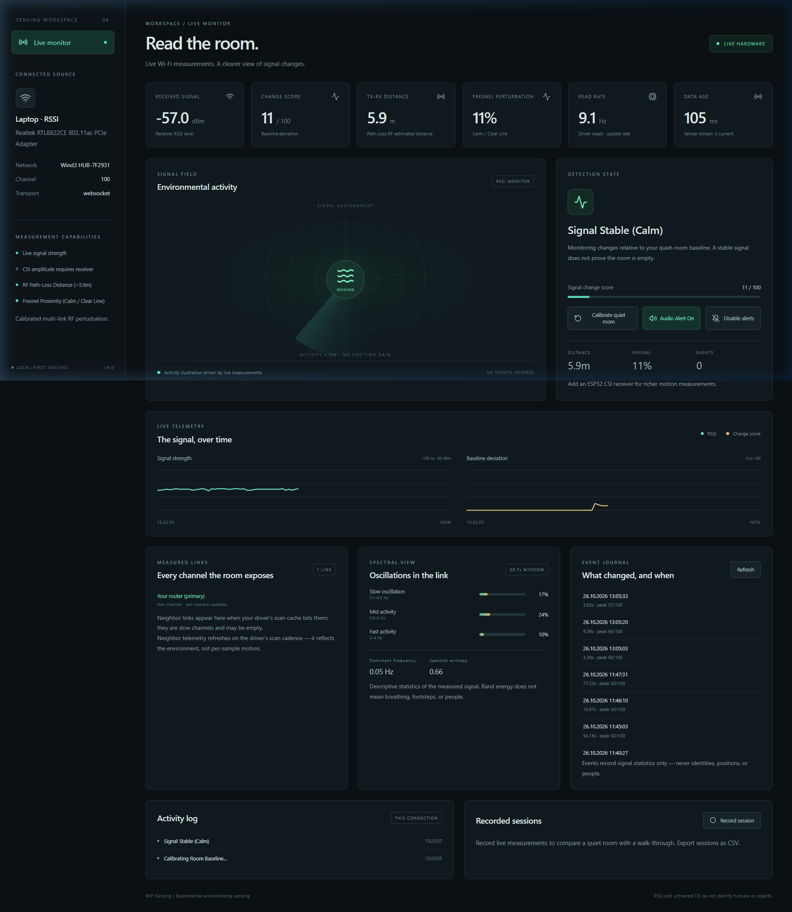
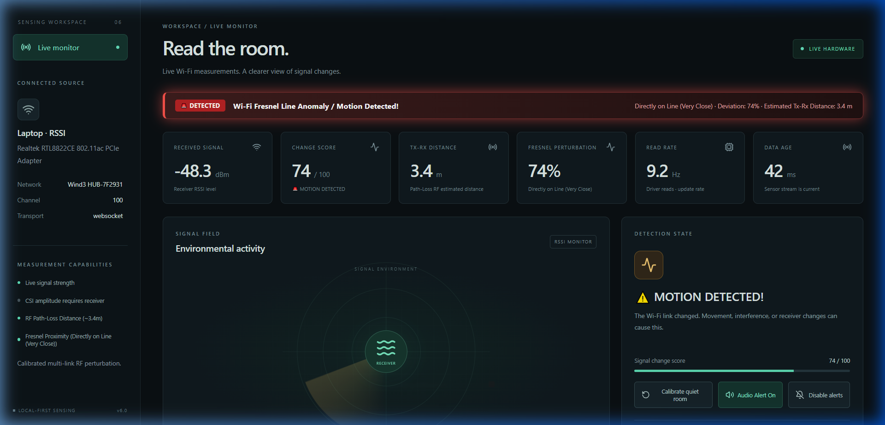

<div align="center">

# 📡 WiFi Motion Sensing & CSI Radar

### Turn any Windows laptop and ESP32 into a privacy-first Wi-Fi sensing instrument.

**Live Signal Monitoring · Multi-Link RSSI Fusion · 52-Subcarrier CSI Pipeline · 3D Observatory**


**Every physical environment leaves an electromagnetic fingerprint on its Wi-Fi. WiFi Sensing reads it — live, locally, and honestly.**

</div>

---

## 🔍 What is WiFi Motion Sensing?

**WiFi Motion Sensing is an open-source wireless radar and RF sensing application for Windows.** It turns the commodity Wi-Fi radio already inside your laptop (or a connected low-cost ESP32) into a responsive motion sensor — **no cameras, no wearable devices, no microphones, and zero surveillance footage required**.

Under the hood, the system operates across two synchronous sensing pipelines:
1. **Laptop Native Mode:** Direct C-level `ctypes` bindings into the Windows Native Wi-Fi API (`wlanapi.dll`) extracting real-time multi-link RSSI at ~10 Hz across your connected router and all visible neighbor access points.
2. **ESP32 CSI Research Pipeline:** Full 52-subcarrier **Channel State Information (CSI)** extraction via USB serial from a $5–10 ESP32/ESP32-S3 board, painting subcarrier amplitude waterfalls and tracking micro-perturbations.

It was engineered as a truthful, scientific alternative to fake "WiFi radar" demos on the internet: every metric, confidence score, and chart explicitly states what the radio hardware can and cannot measure.

---

## 🖥️ Live Radar Monitor Interface

### 1. Signal Stable (Calm Room / Calibrated Baseline)

*Quiet room state: Baseline learned, ambient drift compensation active, RSSI stable at -57 dBm, read rate locked at 9.1 Hz.*

### 2. Motion Detected (Wi-Fi Fresnel Line Perturbation)

*Active motion state: Fresnel anomaly alert triggered (🚨 DETECTED), Change Score spikes to 74/100, Tx-Rx estimated distance drops to 3.4 m, and active radar ripples pulse.*

---

## ✨ Key Features & Architectural Highlights

- ⚡ **V2 Production Stability Engine (`sensing/v2/`):**
  - **Hampel Outlier Identifier ($W=5, 3\times\text{MAD}$):** Cleans transient packet spikes caused by OS scans or channel contention.
  - **Dual-Rate Adaptive Baseline:** Updates dynamic baseline ($\alpha=0.005$) only during ambient quiet, freezing adaptation during active motion to prevent baseline corruption.
  - **Frobenius $L_2$ Norm CSI Normalization:** Cancels hardware AGC gain hops across 52 subcarriers.
  - **TrafficPacer Active Keep-Alive:** Background 20 Hz micro-beacon thread preventing Windows NIC power-save polling, locking driver read rates at steady ~9.2 Hz.
  - *(See full mathematical proofs and literature analysis in [DEVELOPMENT_REPORT.md](DEVELOPMENT_REPORT.md))*
- 🖥️ **Modern Live Radar Monitor:** React 19 single-page dashboard with real-time SVG sparklines, RF path-loss distance estimation, Fresnel perturbation levels, and spectral entropy distribution.
- 🔬 **Multi-Link RSSI Fusion:** Unlike single-link tools, tracks your primary access point **plus visible neighbor APs** as independent environmental channels, using robust cross-link fusion that suppresses single-channel noise.
- 📊 **Rolling Welch Spectral Engine:** A 30-second rolling Welch Power Spectral Density (PSD) analysis on a uniform 10 Hz grid separating **Slow Band ($0.1 \dots 0.5\text{ Hz}$ respiration)** from **Fast Band ($1.0 \dots 4.0\text{ Hz}$ movement & walking)**.
- 🗒️ **Event Journal with Pre/Post Buffering:** Sustained environmental disturbances trigger local recordings with up to 30 seconds of pre-trigger and post-trigger ring-buffered context stored in SQLite.
- 🌊 **52-Subcarrier CSI Waterfall:** Connect an ESP32 flashed with Espressif CSI firmware to inspect live subcarrier magnitude vectors in real-time.
- 🧪 **Labelled Room-Trial Laboratory:** Collect trials tagged with room conditions (`empty_room`, `person_moving`, `fan_interference`, etc.) with built-in per-subcarrier separation analytics.
- 🔒 **100% Local-First & Privacy-Preserving:** Local SQLite storage, zero cloud telemetry, no accounts. Raw RF evidence without recording personal identity or imagery.

## 📐 The Physics of 3D Wi-Fi Sensing: Why a Single Device Cannot Do True 3D

> [!IMPORTANT]
> **Engineering Truth & Physical Constraints:**  
> A single commodity Wi-Fi receiver (e.g., one laptop or one ESP32) **cannot** reconstruct 3D spatial $(x, y, z)$ coordinates, track 3D trajectories, or synthesize human skeletal figures. Claims of extracting full 3D skeletons from a single commodity laptop Wi-Fi antenna are physically impossible and synthetically simulated.

### 1. The Fresnel Ellipsoid Ambiguity
A single Wi-Fi link between a transmitter ($\text{Tx}$) and receiver ($\text{Rx}$) operates over concentric **Fresnel ellipsoids**:
$$|d(\text{Tx}, P) + d(P, \text{Rx}) - d(\text{Tx}, \text{Rx})| = n \frac{\lambda}{2}$$
- **1-Degree-of-Freedom (1 DoF):** An RF perturbation anywhere on the boundary of the 3D ellipsoid shell generates identical phase cancellation and amplitude fading at the receiver.
- A single receiver cannot distinguish whether a disturbance is $1\text{ m}$ up, $1\text{ m}$ down, $1\text{ m}$ to the left, or $1\text{ m}$ to the right. It measures **magnitude of environmental disturbance**, not spatial coordinates.

### 2. Strict Requirements for Real 3D Spatial Localization & Pose Estimation
To genuinely reconstruct 3D spatial positions or human pose from Wi-Fi, the following hardware and algorithmic infrastructure is mandatory:

1. **Distributed Multi-Node Mesh (Multilateration):**
   - Minimum **3 to 4 non-collinear transceiver pairs** distributed around the perimeter of the room.
   - The spatial intersection of multiple independent Fresnel ellipsoids eliminates the rotational ambiguity and solves for the unique $(x, y, z)$ intersection point.
2. **Calibrated MIMO Multi-Antenna Arrays (AoA & ToF):**
   - Minimum $3 \times 3$ or $4 \times 4$ uniform linear or planar antenna arrays with phase-synchronized RF chains.
   - High-resolution array processing algorithms (e.g., 2D-MUSIC, SpotFi, Widar) to resolve Angle-of-Arrival (Azimuth $\theta$ and Elevation $\phi$) and Time-of-Flight (ToF).
3. **Cross-Modal Deep Learning & MoCap Ground Truth:**
   - Neural architectures (like CMU DensePose from WiFi or MIT RF-Pose) require thousands of hours of training data synchronized with millimeter-precision optical motion capture systems (e.g., OptiTrack or Vicon).

---

## 📚 Academic Foundations & Research Literature

This project is built upon rigorous, peer-reviewed foundations in wireless sensing, electromagnetism, and computer vision:

### 1. Fresnel Zone Theory & Radio Propagation
* **[Understanding and Modeling of WiFi-Human Interaction Based on Fresnel Zone Theory](https://dl.acm.org/doi/10.1145/2632048.2632054)**  
  *Hao Wang, Daqing Zhang, Junyi Ma, Yasha Wang, Yuxiang Wang, Dan Wu, Tao Gu, Bing Xie (Peking University)* — **ACM UbiComp**  
  *Impact:* Establishes the ellipsoidal Fresnel zone model explaining why human movement between Tx and Rx induces constructive/destructive interference ($\Delta \phi = \pi$) and deep signal fading.

### 2. Dense 3D Human Pose from Wi-Fi CSI
* **[DensePose From WiFi](https://arxiv.org/abs/2301.00250)**  
  *Jiaqi Geng, Dong Huang, Fernando De la Torre (Carnegie Mellon University - CMU Robotics Institute)* — **arXiv:2301.00250**  
  *Impact:* Proves that commodity Wi-Fi router CSI subcarrier phase and amplitude can be mapped by deep neural networks into dense UV surface coordinates across 24 human body regions.

### 3. Through-Wall Wireless Skeleton Estimation
* **[Through-Wall Human Pose Estimation Using Radio Signals (RF-Pose)](https://rfvision.csail.mit.edu/)**  
  *Mingmin Zhao, Tianhong Li, Mohammad Abu Alsheikh, Yonglong Tian, Hang Zhao, Antonio Torralba, Dina Katabi (MIT CSAIL)* — **IEEE CVPR / ACM SIGCOMM**  
  *Impact:* Foundational work demonstrating cross-modal supervision to extract 14-keypoint human skeletons through walls using radio reflections.

### 4. Contactless Respiration & Vital Signs Sensing
* **[Human Respiration Detection with Commodity Wifi Devices: Do User Location and Body Orientation Matter?](https://dl.acm.org/doi/10.1145/2973750.2973784)**  
  *Hao Wang, Daqing Zhang, Yasha Wang, Jing Deng* — **ACM MobiCom**  
  *Impact:* Validates subcarrier sensitivity variations and defines the slow-band spectral filter ($0.1 \dots 0.5\text{ Hz}$) for extracting minute human chest movements.
* **[Wi-Sleep: Contactless Sleep Monitoring via WiFi Signals](https://ieeexplore.ieee.org/document/7091040/)**  
  *Xuefeng Liu, Jiannong Cao, ShaoJie Tang, Jiaqi Wen* — **IEEE INFOCOM / IEEE TMC**  
  *Impact:* Demonstrates continuous sleep posture and breathing rate detection using commercial-off-the-shelf Wi-Fi links.

### 5. Cross-Domain Gesture & Doppler Tracking
* **[Widar 3.0: Zero-Effort Cross-Domain Gesture Recognition with Wi-Fi](https://tns.thss.tsinghua.edu.cn/widar3.0/)**  
  *Zheng Yang, Zimu Zhou, Chenshu Wu, Yunhao Liu (Tsinghua University)* — **IEEE Transactions on Mobile Computing / ACM MobiSys**  
  *Impact:* Formulates Body-coordinate Velocity Profiles (BVP) and Doppler Frequency Shifts (DFS) derived from CSI subcarrier amplitudes.

### 6. Official Global Standard: IEEE 802.11bf
* **[Wi-Fi Sensing: An Overview of IEEE 802.11bf](https://ieeexplore.ieee.org/document/9941042/)**  
  *Claudio da Silva, Carlos Cordeiro et al.* — **IEEE Communications Magazine (DOI: 10.1109/MCOM.001.2100858)**  
  *Impact:* Outlines the international IEEE standard formally standardizing WLAN stations as dedicated wireless radar and presence sensors.

### 7. Multi-Modal Benchmark Datasets
* **[MM-Fi: Multi-Modal Non-Intrusive 4D Human Dataset for Versatile Wireless Sensing](https://github.com/ybhbingo/MMFi_dataset)**  
  *Jianfei Yang, He Huang, Yanjun Zou, Han Zou, Lihua Xie* — **NeurIPS 2023**  
  *Impact:* Synchronized dataset pairing Wi-Fi CSI (52 subcarriers), mmWave radar, LiDAR, and RGB-D video.
* **[SenseFi: A Library and Benchmark on Deep-Learning-Based WiFi Human Sensing](https://github.com/xyanchen/WiFi-CSI-Sensing-Benchmark)**  
  *Chen Chen, Yanxiang Jiang et al.* — **Patterns (Cell Press)**  
  *Impact:* Unified benchmarking library evaluating CNN, RNN, GRU, and Transformer architectures on Wi-Fi CSI data.

### 8. Embedded Edge Wi-Fi Sensing
* **[Tools and Methods for Achieving Wi-Fi Sensing in Embedded Devices](https://www.mdpi.com/1424-8220/25/1/15)**  
  *Albany Armenta et al.* — **Sensors (MDPI, 2025)**  
  *Impact:* Details lightweight machine learning models (TensorFlow Lite Micro) executing CSI presence detection directly on an ESP32-S3.

---

## 🔗 Upstream Open-Source Provenance & Credits

This project builds on and acknowledges the following foundational open-source projects:

* **[RuView (github.com/ruvnet/RuView)](https://github.com/ruvnet/RuView):**  
  Created by **@ruvnet**. The 3D Observatory user interface, post-processing shaders, wireframe skeleton rendering, and camera controls in this project are adapted from RuView's MIT-licensed `ui/observatory.html` (see [PROVENANCE.md](frontend/observatory/PROVENANCE.md)).
* **[ESP-CSI (github.com/espressif/esp-csi)](https://github.com/espressif/esp-csi):**  
  Official repository by **Espressif Systems**. Provides the firmware examples (`csi_recv_router`) and serial packet structures used by our CSI parser.
* **[Upstream Base Repository (github.com/tatheer583/WIWAVE-MOTION)](https://github.com/tatheer583/WIWAVE-MOTION):**  
  Original Windows RSSI motion sensing project baseline created by **@tatheer583**.

---

## 🚀 Quick Start (Windows)

### Prerequisites
* Windows 10 or 11 with an active Wi-Fi adapter.
* Python 3.10+ installed.
* Node.js 18+ (for building the frontend).

### Installation & Run

```powershell
# 1. Clone the repository
git clone https://github.com/your-username/wifi-motion-sensing.git
cd wifi-motion-sensing

# 2. Set up Python environment
python -m venv .venv
.\.venv\Scripts\python.exe -m pip install -r requirements.txt

# 3. Build the React 19 Frontend
cd frontend
npm ci
npm run build
cd ..

# 4. Start the live hardware server
.\scripts\start-live.ps1
```

Open **http://127.0.0.1:8000** in your browser.  
Keep the room quiet for the initial **20-second calibration** while the baseline is established.

* **Live Hardware Monitor:** `http://127.0.0.1:8000/monitor.html`
* **3D Virtual Observatory:** `http://127.0.0.1:8000/`
* **Simulation Mode:** Set `SIMULATION_MODE=true` to test the UI without active Wi-Fi.

---

## 🧠 System Architecture

```
Native WLAN API (wlanapi.dll)          ESP32 Serial (Espressif CSV)
        │  ~10 Hz per-link RSSI                │  CSI I/Q → Amplitudes
        ▼                                      ▼
  ChangeDetector ── Median/MAD baseline · 2 s window · Hysteresis trigger/release
        │            Per-channel z-scores · Primary + Neighbor link fusion
        ▼
  SpectralAnalyzer ── Welch PSD on uniform 10 Hz grid (30 s sliding window)
        │
        ▼
  Event Journal ── Pre/Post ring buffers ── SQLite (aiosqlite) ── UI + CSV export
        │
        ▼
  FastAPI Server (10 Hz WebSocket /ws/radar) ── React 19 Live Monitor + 3D Observatory
```

---

## 📡 REST & WebSocket API

| Method & Route | Purpose |
| :--- | :--- |
| `GET /api/health` | Sensor health, active source, sample age, and read rate |
| `GET /api/poll` | Latest snapshot with links, spectral statistics, and CSI preview |
| `WS /ws/radar` | Real-time binary/JSON telemetry broadcast (up to 10 Hz) |
| `POST /api/calibrate` | Force restart quiet-room baseline learning |
| `POST /session/start` · `stop` | Start/stop a local recording session |
| `GET /sessions` · `GET /session/{id}/export` | List recordings, export raw telemetry to CSV |
| `GET /api/events` · `GET /api/events/{id}` | Access the ring-buffered motion event journal |
| `GET /api/csi/trials` (+ `/start`, `/stop`) | Manage labelled ESP32 CSI training trials |
| `GET /api/capabilities` | Inspect exact hardware limits of the connected radio |

---

## 📖 Citation (BibTeX)

If you use this project, its datasets, or its signal processing pipeline in your academic research, please cite it as:

```bibtex
@software{wifi_motion_sensing_2026,
  title   = {WiFi Motion Sensing: Open-Source Real-Time RF Radar and CSI Sensing Instrument},
  author  = {Mustafa Yagci and Contributors},
  year    = {2026},
  url     = {https://github.com/your-username/wifi-motion-sensing},
  note    = {Adapted from RuView (ruvnet) and ESP-CSI (Espressif)}
}
```

---

## 📄 License

This project is licensed under the **MIT License** — see the [LICENSE](LICENSE) file for details.  
Observatory 3D rendering modules adapted from **[RuView](https://github.com/ruvnet/RuView)** (MIT License, Copyright © 2026 ruvnet).
